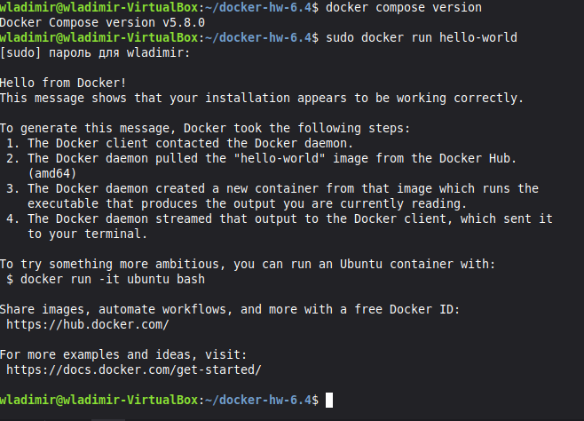
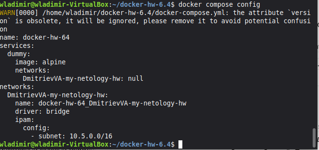
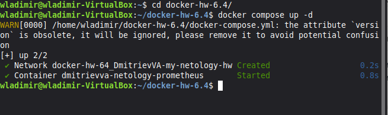
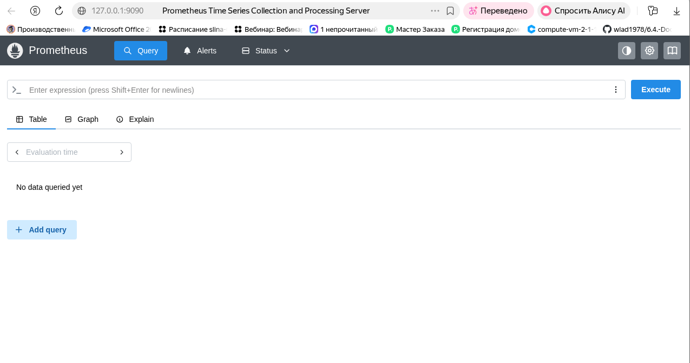
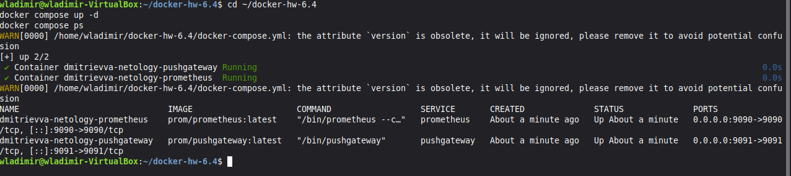
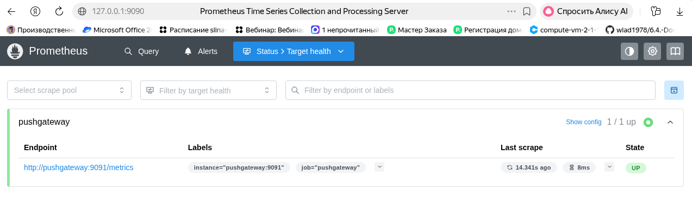

# Домашнее задание к занятию "`Docker. Часть 2`" - `Дмитриев Владимир`


### Инструкция по выполнению домашнего задания

   1. Сделайте `fork` данного репозитория к себе в Github и переименуйте его по названию или номеру занятия, например, https://github.com/имя-вашего-репозитория/git-hw или  https://github.com/имя-вашего-репозитория/7-1-ansible-hw).
   2. Выполните клонирование данного репозитория к себе на ПК с помощью команды `git clone`.
   3. Выполните домашнее задание и заполните у себя локально этот файл README.md:
      - впишите вверху название занятия и вашу фамилию и имя
      - в каждом задании добавьте решение в требуемом виде (текст/код/скриншоты/ссылка)
      - для корректного добавления скриншотов воспользуйтесь [инструкцией "Как вставить скриншот в шаблон с решением](https://github.com/netology-code/sys-pattern-homework/blob/main/screen-instruction.md)
      - при оформлении используйте возможности языка разметки md (коротко об этом можно посмотреть в [инструкции  по MarkDown](https://github.com/netology-code/sys-pattern-homework/blob/main/md-instruction.md))
   4. После завершения работы над домашним заданием сделайте коммит (`git commit -m "comment"`) и отправьте его на Github (`git push origin`);
   5. В личном кабинете прикрепите и отправьте ссылку на решение в виде md-файла в вашем Github.
   6. Любые вопросы по выполнению заданий спрашивайте в разделе “Вопросы по заданию” в личном кабинете.
   
Желаем успехов в выполнении домашнего задания!
   
### Дополнительные материалы, которые могут быть полезны для выполнения задания

1. [Руководство по оформлению Markdown файлов](https://gist.github.com/Jekins/2bf2d0638163f1294637#Code)

---

### Задание 1

`Установите Docker Compose и опишите, для чего он нужен и как может улучшить лично вашу жизнь.`

1. `Как улучшит вашу жизнь
Воспроизводимость. Окружение описано в файле, а не в вашей голове. Проект запускается одинаково на ноутбуке, на сервере и у коллеги — конфигурация больше не «знание только для вас».
Одна команда вместо десяти. docker compose up -d — старт, docker compose down — остановка с удалением контейнеров и сетей. Данные в томах сохраняются.
Чистота системы. Хотите убрать проект целиком — docker compose down -v, и ничего не осталось в системе. Никаких «а где лежала база от того проекта?».
Отладка реальных связок. База + бэкенд + фронтенд локально поднимаются за минуту, а не настраиваются вручную полдня.
Портфолио. compose.yaml в репозитории — то, что первым видит ревьюер или HR: проект запускается без танцев с бубном.`

`При необходимости прикрепитe сюда скриншоты
`


---

### Задание 2

`Создайте файл docker-compose.yml и внесите туда первичные настройки:

version;
services;
volumes;
networks.
При выполнении задания используйте подсеть 10.5.0.0/16. Ваша подсеть должна называться: <ваши фамилия и инициалы>-my-netology-hw. Все приложения из последующих заданий должны находиться в этой конфигурации.`

1. `Создаём файл .`


```
Поле для вставки кода...
....version: "3.8"

services:
  dummy:
    image: alpine
    networks:
      - DmitrievVA-my-netology-hw

volumes:
  dummy-data:

networks:
  DmitrievVA-my-netology-hw:
    driver: bridge
    ipam:
      config:
        - subnet: 10.5.0.0/16

....
....
....
```

`При необходимости прикрепитe сюда скриншоты
`


---

### Задание 3

`Выполните действия:

Создайте конфигурацию docker-compose для Prometheus с именем контейнера dmitrievva-netology-prometheus.
Добавьте необходимые тома с данными и конфигурацией (конфигурация лежит в репозитории в директории 6-04/prometheus ).
Обеспечьте внешний доступ к порту 9090 c докер-сервера..`

1. `Редактируем файлы docker-compose.yml`
2. `Редактируем файл prometheus.yml`
3. `Проверяем доступность сервера`


```
Поле для вставки кода...
....
docker-compose.yml

version: "3.8"

services:
  prometheus:
    image: prom/prometheus:latest
    container_name: dmitrievva-netology-prometheus
    restart: unless-stopped
    ports:
      - "9090:9090"
    volumes:
      - ./prometheus:/etc/prometheus
      - prometheus-data:/prometheus
    command:
      - "--config.file=/etc/prometheus/prometheus.yml"
      - "--storage.tsdb.path=/prometheus"
    networks:
      - DmitrievVA-my-netology-hw

volumes:
  prometheus-data:

networks:
  DmitrievVA-my-netology-hw:
    driver: bridge
    ipam:
      config:
        - subnet: 10.5.0.0/16
....
prometheus.yml

# my global config
global:
  scrape_interval: 15s # Set the scrape interval to every 15 seconds. Default is every 1 minute.
  evaluation_interval: 15s # Evaluate rules every 15 seconds. The default is every 1 minute.
  # scrape_timeout is set to the global default (10s).

# Alertmanager configuration
alerting:
  alertmanagers:
    - static_configs:
        - targets:
            # - alertmanager:9093

# Load rules once and periodically evaluate them according to the global 'evaluation_interval'.
rule_files:
  # - "first_rules.yml"
  # - "second_rules.yml"

# A scrape configuration containing exactly one endpoint to scrape:
# Here it's Prometheus itself.
scrape_configs:
  # The job name is added as a label `job=<job_name>` to any timeseries scraped from this config.
  # - job_name: "docker-server"
    # metrics_path defaults to '/metrics'
    # scheme defaults to 'http'.
  #   static_configs:
  #     - targets: ["172.17.0.1:9100"]

  - job_name: 'pushgateway'
    honor_labels: true
    static_configs:
      - targets: ["pushgateway:9091"]
....
....
```

`При необходимости прикрепитe сюда скриншоты

`

### Задание 4

`Выполните действия:

Создайте конфигурацию docker-compose для Pushgateway с именем контейнера dmitrievva-netology-pushgateway.
Обеспечьте внешний доступ к порту 9091 c докер-сервера.`

1. `Редактируем файл docker-compose.yml .` 

```
docker-compose.yml

version: "3.8"

services:
  prometheus:
    image: prom/prometheus:latest
    container_name: dmitrievva-netology-prometheus
    restart: unless-stopped
    ports:
      - "9090:9090"
    volumes:
      - ./prometheus:/etc/prometheus
      - prometheus-data:/prometheus
    command:
      - "--config.file=/etc/prometheus/prometheus.yml"
      - "--storage.tsdb.path=/prometheus"
    networks:
      - DmitrievVA-my-netology-hw

  pushgateway:
    image: prom/pushgateway:latest
    container_name: dmitrievva-netology-pushgateway
    restart: unless-stopped
    ports:
      - "9091:9091"
    networks:
      - DmitrievVA-my-netology-hw

volumes:
  prometheus-data:

networks:
  DmitrievVA-my-netology-hw:
    driver: bridge
    ipam:
      config:
        - subnet: 10.5.0.0/16

....
....
....
....
```

`При необходимости прикрепитe сюда скриншоты

`
....
### Задание 5
  `Выполните действия:

Создайте конфигурацию docker-compose для Grafana с именем контейнера dmitrievva-netology-grafana.
Добавьте необходимые тома с данными и конфигурацией (конфигурация лежит в репозитории в директории 6-04/grafana.
Добавьте переменную окружения с путем до файла с кастомными настройками (должен быть в томе), в самом файле пропишите логин=dmitrievva пароль=netology.
Обеспечьте внешний доступ к порту 3000 c порта 80 докер-сервера.`
.....


1  `Редактируем файл`
....

version: "3.8"

services:
  prometheus:
    image: prom/prometheus:latest
    container_name: dmitrievva-netology-prometheus
    restart: unless-stopped
    ports:
      - "9090:9090"
    volumes:
      - ./prometheus:/etc/prometheus
      - prometheus-data:/prometheus
    command:
      - "--config.file=/etc/prometheus/prometheus.yml"
      - "--storage.tsdb.path=/prometheus"
    networks:
      - DmitrievVA-my-netology-hw

  pushgateway:
    image: prom/pushgateway:latest
    container_name: dmitrievva-netology-pushgateway
    restart: unless-stopped
    ports:
      - "9091:9091"
    networks:
      - DmitrievVA-my-netology-hw

  grafana:
    image: grafana/grafana:latest
    container_name: dmitrievva-netology-grafana
    restart: unless-stopped
    ports:
      - "80:3000"
    environment:
      - GF_PATHS_CONFIG=/etc/grafana/custom.ini
    volumes:
      - ./grafana/custom.ini:/etc/grafana/custom.ini
      - grafana-data:/var/lib/grafana
    networks:
      - DmitrievVA-my-netology-hw

volumes:
  prometheus-data:
  grafana-data:

networks:
  DmitrievVA-my-netology-hw:
    driver: bridge
    ipam:
      config:
        - subnet: 10.5.0.0/16

....

``
``


### Задание6
`Выполните действия.

Настройте поочередность запуска контейнеров.
Настройте режимы перезапуска для контейнеров.
Настройте использование контейнерами одной сети.
Запустите сценарий в detached режиме.`

....
1  `Редактируем файл`
....

version: "3.8"

services:
  pushgateway:
    image: prom/pushgateway:latest
    container_name: dmitrievva-netology-pushgateway
    restart: unless-stopped
    networks:
      - DmitrievVA-my-netology-hw

  prometheus:
    image: prom/prometheus:latest
    container_name: dmitrievva-netology-prometheus
    restart: unless-stopped
    depends_on:
      - pushgateway
    ports:
      - "9090:9090"
    volumes:
      - ./prometheus:/etc/prometheus
      - prometheus-data:/prometheus
    command:
      - "--config.file=/etc/prometheus/prometheus.yml"
      - "--storage.tsdb.path=/prometheus"
    networks:
      - DmitrievVA-my-netology-hw

  grafana:
    image: grafana/grafana:latest
    container_name: dmitrievva-netology-grafana
    restart: unless-stopped
    depends_on:
      - prometheus
    ports:
      - "80:3000"
    environment:
      - GF_PATHS_CONFIG=/etc/grafana/custom.ini
    volumes:
      - ./grafana/custom.ini:/etc/grafana/custom.ini
      - grafana-data:/var/lib/grafana
    networks:
      - DmitrievVA-my-netology-hw

volumes:
  prometheus-data:
  grafana-data:

networks:
  DmitrievVA-my-netology-hw:
    driver: bridge
    ipam:
      config:
        - subnet: 10.5.0.0/16

....


``
....

###  Задание7
``
``
``
....

services:
  pushgateway:
    image: prom/pushgateway:latest
    container_name: dmitrievva-netology-pushgateway
    restart: unless-stopped
    ports:
      - "9091:9091"
    networks:
      - DmitrievVA-my-netology-hw

  prometheus:
    image: prom/prometheus:latest
    container_name: dmitrievva-netology-prometheus
    restart: unless-stopped
    depends_on:
      - pushgateway
    ports:
      - "9090:9090"
    volumes:
      - ./prometheus:/etc/prometheus
      - prometheus-data:/prometheus
    command:
      - "--config.file=/etc/prometheus/prometheus.yml"
      - "--storage.tsdb.path=/prometheus"
    networks:
      - DmitrievVA-my-netology-hw

  grafana:
    image: grafana/grafana:latest
    container_name: dmitrievva-netology-grafana
    restart: unless-stopped
    depends_on:
      - prometheus
    ports:
      - "80:3000"
    environment:
      - GF_PATHS_CONFIG=/etc/grafana/custom.ini
    volumes:
      - ./grafana/custom.ini:/etc/grafana/custom.ini
      - grafana-data:/var/lib/grafana
    networks:
      - DmitrievVA-my-netology-hw

volumes:
  prometheus-data:
  grafana-data:

networks:
  DmitrievVA-my-netology-hw:
    driver: bridge
    ipam:
      config:
        - subnet: 10.5.0.0/16

### Задание8

``
